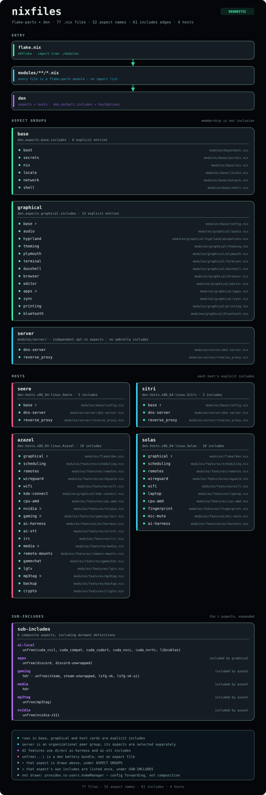

# nixfiles

A NixOS + [home-manager](https://github.com/nix-community/home-manager) configuration for a complete Wayland desktop ([Hyprland](https://hyprland.org), [DankMaterialShell](https://github.com/AvengeMedia/DankMaterialShell), [stylix](https://github.com/danth/stylix)), managed as one flake across **Azazel** (desktop / gaming), **Solas** (laptop), and the headless Wyse DNS appliances **Seere** and **Sitri**.

> **AI disclaimer:** Parts of this configuration and this README were written with AI assistance. Review anything you adopt before adding it to your own system.

## Before you use

> [!WARNING]
> This repository is **not designed to be used as is**. It may break your system if you rebuild without adjusting it first.

1. Replace the hardware configurations in `./modules/hosts/<host>/` with your own.
2. Review the package selections and settings.
3. Update the user and host names referenced throughout.

## Architecture

The tree follows the **dendritic pattern**: every file under `./modules/` is a [`flake-parts`](https://flake.parts) module, auto-imported by [`import-tree`](https://github.com/vic/import-tree). There is no central import list.

Hosts are assembled from **den aspects** ([denful/den](https://github.com/denful/den)). Feature modules register `den.aspects.<name>`, while `modules/flake/` also contains flake infrastructure. An aspect is a named bundle of NixOS and home-manager config. `modules/flake/den.nix` shares `base` across all four hosts; `graphical` explicitly composes audio and UI capabilities for Azazel and Solas, whose host includes also select scheduling, remotes, WireGuard and Wi-Fi from `modules/features/`. Seere and Sitri keep their hardware and storage in their own host folders and explicitly select the independent `dns-server` and `reverse_proxy` aspects from the peer `server` group under `modules/server/`, with Home Manager but no graphical desktop. The server group is organizational only, not a runtime umbrella. The shared `shochraos` account uses SOPS and Home Manager on all four hosts. den forwards the home-manager configuration with `osConfig` available. Shared modules read `host.*` options, declared once in `modules/flake/options.nix`, for data shared across aspects or translated into configuration. Host-specific settings that need neither use native NixOS or home-manager options directly in the host's `config.nix`.

<details>
<summary>Architecture graph</summary>



</details>

> [!TIP]
> For substantive feature behavior, define `den.aspects.<name>` in a file under `modules/`, then add `<name>` to an includes list in `modules/flake/den.nix`. Host, base and graphical composition stays central; a feature owns its own dependency includes and scoped unfree allowances. Package-only additions belong in an existing shared or per-host `home.packages` or `environment.systemPackages` list; they do not need a dedicated aspect. A new file is invisible to the flake until it is git-tracked, so `git add -N` it before evaluating.

## Directory layout

- `./flake.nix` — entry point; auto-imports `./modules/`.
- `./modules/flake/` — assembly logic (`den.nix`, `options.nix`, `paths.nix`) plus the devshell, the treefmt gate and the aspect-graph check. Start here.
- `./modules/base/`, `./modules/graphical/`, `./modules/features/`, `./modules/server/` — organizational aspect groups. Directory membership registers definitions, not inclusion: base and graphical compose their capabilities explicitly, hosts opt into features, and each server capability is selected separately.
- `./modules/hosts/<host>/` — `config.nix` (native settings and shared `host.*` data), `hardware.nix` and `filesystems.nix` for each host.
- `./modules/users/` — per-user aspects, resolved by name.
- `./pkgs/<name>/package.nix` — local package recipes, reached through `config.packageSources`. Single-consumer recipes use `pkgs.callPackage` in the consumer; overlays remain where shared package-set overrides are needed.
- `./configs/`, `./assets/` — raw config files, templates, scripts, patches, agent rules, and the rendered aspect graph with the script that draws it.
- `./secrets/` — [sops-nix](https://github.com/Mic92/sops-nix)-encrypted secrets.

## Development

```bash
nh-switch        # build and switch
nh-boot          # build and set as the boot default
nh-update        # update inputs, build, set as boot default

nix fmt          # format and lint: nixfmt, shfmt, shellcheck, statix, deadnix, actionlint
nix flake check  # formatting, linting and graph freshness
```

The only CI checks are formatting/linting and aspect-graph freshness, via `nix flake check`; application builds and runtime testing are separate. Local commit hooks remain installed and enabled. Verify affected package and host builds before switching. For evaluation only, use `nix flake check --no-build --option allow-import-from-derivation false`.

That SVG ships with the change that made it stale. The pre-commit hook redraws it and fails if the result differs from the index; it never stages files. In `nix develop`, run `python3 assets/scripts/draw-aspects.py 820`, review the result and stage it yourself. The devshell supplies Python and ripgrep and installs the local commit hooks. GitHub Actions runs `nix flake check` on pushes, pull requests and a weekly schedule. Action revisions are pinned to commits (checkout v7 and install-nix-action v31).

Secrets are encrypted at rest with SOPS. `sops edit secrets/secrets.yaml` decrypts values for the editor and re-encrypts them when saving, even with a scripted editor. Perform secret edits yourself with trusted tooling; never commit plaintext. Configuration consumes `config.sops.placeholder` or `.path` rather than reading secret values during evaluation.

## Runtime policies

- Azazel's remote shares are native SMB (CIFS) on-demand automounts with a 30-second mount timeout and five-minute idle unmount. Files appear owned by the desktop user, with private data-only access (`0600` files, `0700` directories, `noexec`). The mounts authenticate with the root-only SOPS secrets `astaroth/smb-username` and `astaroth/smb-password`; a failed initial attempt does not block boot, and later access can retry.
- Azazel waits for NetworkManager and retains its NVMe APST workaround. Solas skips wait-online and retains normal NVMe power saving.
- `hdr <foreground command> [arguments...]` owns HDR for the launched process group, forwards stop signals and waits before release. Use a foreground launch rather than a broker that starts a game in an unrelated process. It no longer guesses ownership from newly appearing window classes. mpv has its own PID-scoped lease. `hdr-set on` / `hdr-set off` control an independent manual lease; releasing one lease does not turn off another. DMS display settings remain untouched, and removing the last lease restores that baseline. Dead process leases are reaped within the 30-second timer interval.
- Calendar conflicts retain the existing `local wins` policy: the entire local item replaces its remote counterpart, not a field-level merge. Before resolving a disputed item, stop synchronization on both devices and preserve both copies. Recover the losing remote version from server version history or a backup before resuming.
- The NVIDIA-wide library paths remain in place because their runtime consumers have not been ruled out. The HDR launcher isolates compositor commands from that environment and restores it only for the game.

Workaround removal conditions are recorded in [WORKAROUNDS.md](WORKAROUNDS.md).

## License

[MIT](LICENSE) © 2026 Shochraos. The license covers the code in this repository; everything under `./secrets/` and any personal data is excluded.
