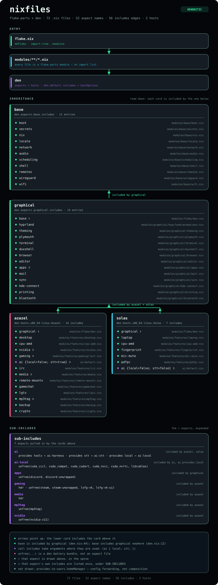

# nixfiles

A NixOS + [home-manager](https://github.com/nix-community/home-manager) configuration for a complete Wayland desktop ([Hyprland](https://hyprland.org), [DankMaterialShell](https://github.com/AvengeMedia/DankMaterialShell), [stylix](https://github.com/danth/stylix)), managed as one flake across two machines: **Azazel** (desktop / gaming) and **Solas** (laptop).

> **AI disclaimer:** Parts of this configuration and this README were written with AI assistance. Review anything you adopt before adding it to your own system.

## Before you use

> [!WARNING]
> This repository is **not designed to be used as is**. It may break your system if you rebuild without adjusting it first.

1. Replace the hardware configurations in `./modules/hosts/<host>/` with your own.
2. Review the package selections and settings.
3. Update the user and host names referenced throughout.

## Architecture

The tree follows the **dendritic pattern**: every file under `./modules/` is a [`flake-parts`](https://flake.parts) module, auto-imported by [`import-tree`](https://github.com/vic/import-tree). There is no central import list.

Hosts are assembled from **den aspects** ([denful/den](https://github.com/denful/den)). Each module registers `den.aspects.<name>`, a named bundle of NixOS and home-manager config, and `modules/flake/den.nix` wires those names into `base` → `graphical` → per-host includes, plus exactly one form-factor aspect. den forwards the home-manager half itself, with `osConfig` available. Shared modules never fork per host: they read `host.*` options, declared once in `modules/flake/options.nix`, that the host's `config.nix` fills in.

<details>
<summary>Architecture graph</summary>



</details>

> [!TIP]
> Adding a feature is two steps: define `den.aspects.<name>` in a file under `modules/`, then add `<name>` to an includes list in `modules/flake/den.nix`. A new file is invisible to the flake until it is git-tracked, so `git add -N` it before evaluating.

## Directory layout

- `./flake.nix` — entry point; auto-imports `./modules/`.
- `./modules/flake/` — assembly logic (`den.nix`, `options.nix`, `paths.nix`) plus the devshell, the treefmt gate and the aspect-graph check. Start here.
- `./modules/base/`, `./modules/graphical/`, `./modules/features/` — the aspect layers. A file's folder names the layer that includes it.
- `./modules/hosts/<host>/` — `config.nix` (`host.*` settings), `hardware.nix`, `filesystems.nix`.
- `./modules/users/` — per-user aspects, resolved by name.
- `./pkgs/<name>/package.nix` — packages nixpkgs lacks, reached through a named overlay in the owning aspect.
- `./configs/`, `./assets/` — raw config files, templates, scripts, patches, agent rules, and the rendered aspect graph with the script that draws it.
- `./secrets/` — [sops-nix](https://github.com/Mic92/sops-nix)-encrypted secrets.

## Development

```bash
nh-switch        # build and switch
nh-boot          # build and set as the boot default
nh-update        # update inputs, build, set as boot default

nix fmt          # format and lint: nixfmt, shfmt, shellcheck, statix, deadnix, actionlint
nix flake check  # the gate: treefmt, commit hooks, aspect graph
```

The gate is `nix fmt` plus `nix flake check`, and both hosts must build through `nh-switch`. No unit tests exist. `nix flake check` builds three checks: the treefmt pass, the commit hooks, and `aspect-graph`, which re-renders the diagram and fails when `assets/aspect-graph.svg` no longer matches the modules.

That SVG ships with the change that made it stale. The pre-commit hook redraws and stages it whenever a file under `modules/` or the drawing script changes; `python3 assets/scripts/draw-aspects.py 820` produces it without the hook. Entering the devshell once per clone installs that hook, so a formatting failure means running `nix fmt` and committing again. GitHub Actions runs `nix flake check` on every push plus a weekly schedule, and a second workflow reports `nix fmt` drift.

Secrets are sops-encrypted end to end. Edit them with `sops edit secrets/secrets.yaml` (a scripted `EDITOR` renames keys without decrypting values), never commit plaintext, and reference values through `config.sops.placeholder` or `.path` instead of reading them.

## License

[MIT](LICENSE) © 2026 Shochraos. The license covers the code in this repository; everything under `./secrets/` and any personal data is excluded.
